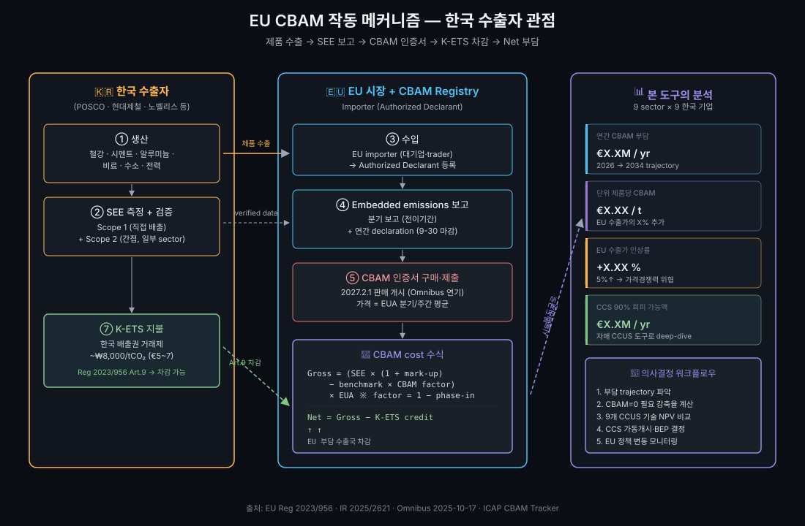

# 📘 EU CBAM 영향 계산기 — 사용자 매뉴얼

> 본 매뉴얼은 EU 탄소국경조정제도(CBAM)·EU ETS·CCS 시장에 어느 정도 익숙하신 분(산업 분석가, IR/ESG 담당자, 컨설턴트, 기술사업화 담당자)을 위한 실무 가이드입니다. CBAM이 처음이신 분은 1장의 메커니즘 다이어그램부터 보시고, 익숙하신 분은 3장 시나리오 흐름부터 시작해도 됩니다.

---

## 1. CBAM이 무엇이고, 어떻게 작동하는가

### 1.1 한 줄 요약
> **EU가 수입하는 6개 탄소집약 제품**(철강·시멘트·알루미늄·비료·수소·전력)의 **내재 탄소량(SEE)에 대해, EU 내 생산자가 ETS에서 지불하는 수준의 carbon price를 부과**하는 제도. 2026년 1월 본격 시행, 2034년 100% 부과 도달.

### 1.2 작동 메커니즘 다이어그램



> 다이어그램이 보이지 않으면 [`cbam_mechanism.svg`](./cbam_mechanism.svg)를 직접 열어보세요.

**핵심 흐름** (5단계):
1. **🇰🇷 한국 수출자** (POSCO·현대제철·노벨리스 등)가 제품 생산 + SEE 측정 + verified data 준비
2. **EU importer (Authorized Declarant)**가 분기 보고 + 연간 declaration 제출
3. **CBAM Registry**가 인증서 수 = SEE × (1 + mark-up) − Free benchmark × CBAM factor 계산 (× EUA)
4. **K-ETS 차감** (Art.9): 한국에서 이미 지불한 carbon price를 차감
5. **Net CBAM cost** 확정 → 인증서 구매·제출

**수식 한 줄** (IR 2025/2620):
```
인증서 수 = SEE × (1 + mark-up) − Free benchmark × CBAM factor   (음수면 0)
Gross     = 인증서 수 × EUA
Net       = Gross − K-ETS credit (verified)
연간 부담 = Net × EU 수출량
CBAM factor = 1 − Phase-in   (2026 97.5% → 2030 51.5% → 2034 0%)
```

> ⚠️ benchmark 초과분은 **2026년부터 전액** 부과됩니다. phase-in으로 늘어나는 건 benchmark분에 대한 무상할당 공제가 줄어드는 몫입니다.
>
> 🧾 **인증서 가격**: 2026년분은 분기별 EUA 경매 평균가(집행위 발표 Q1 €75.36, Q2 €75.28, Q3 €82.32 — 미발표 분기는 사이드바 EUA)이고, 2027년분부터는 주간 평균입니다.

### 1.3 Phase-in 일정 (무상할당 공제 축소)

| 연도 | Phase-in | CBAM factor (무상할당 공제) |
|---|---|---|
| 2023.10 ~ 2025 | **0% (보고만)** | 100% |
| **2026** ⭐ | **2.5%** | 97.5% |
| 2027 | 5.0% | 95.0% |
| 2028 | 10.0% | 90.0% |
| 2029 | 22.5% | 77.5% |
| **2030** ⭐ 변곡점 | **48.5%** | 51.5% |
| 2031 | 61.0% | 39.0% |
| 2032 | 73.5% | 26.5% |
| 2033 | 86.0% | 14.0% |
| **2034** ⭐ | **100%** | **0%** |

> 💡 **2030년이 변곡점**. 무상할당 공제가 77.5% → 51.5%로 크게 줄어 부담이 가파르게 늘어납니다. 단, benchmark 초과분은 2026년부터 이미 전액 부과됩니다.

#### 규제 시나리오: 2040 개편안 (제안·미확정)

사이드바 **규제 시나리오**에서 2026-07-17 집행위 ETS 개편안(COM(2026) 616)을 고를 수 있습니다. 기본값은 현행법입니다.

| 연도 | 현행법 무상할당 공제 | 개편안 무상할당 공제 |
|---|---|---|
| 2028 | 90.0% | 91.5% |
| 2029 | 77.5% | 81.0% |
| 2030 | 51.5% | 59.0% |
| 2031 | 39.0% | 48.0% |
| 2032 | 26.5% | 37.5% |
| 2033 | 14.0% | 27.0% |
| 2034~2037 | 0% | 15.0% |
| 2038~ | 0% | 0% |

> ⚠️ 의회·이사회 입장이 아직 없는 **제안**입니다. 수치가 바뀔 수 있으니 비교용으로만 쓰세요.

### 1.4 6개 sector + EU benchmark (단위: tCO₂/t product)

| Sector | EU Free Benchmark | 한국 기본값 (EU) | 한국 평균 SEE | Gap (Free benchmark 대비 초과) |
|---|---|---|---|---|
| 철강 BF-BOF (HRC) | 1.370 | 2.118 | 1.99 (POSCO 직접배출) | **+0.620** |
| 철강 DRI-EAF | 0.481 | 2.118 ※ | 1.0 (천연가스 DRI, IEA) | +0.519 |
| 철강 Scrap-EAF | 0.072 | 2.118 ※ | 0.15 (직접배출) | +0.078 |
| 시멘트 (clinker) | 0.666 | 0.92 | 0.81 | +0.144 |
| 알루미늄 (primary) | 1.423 (재생 0.091) | 0.36 (재생) | 3.0 (수입 primary ingot) | +1.577 |
| 비료 NH₃ | 1.522 | 3.13 (기타국가) | 2.0 | +0.478 |
| 수소 (gray) | 5.089 | 14.03 | 9.0 (생산 공정) | +3.911 |
| 전력 (Grid) | 0 (공제 없음) | — | 0.417 (2023 국가) | +0.417 |

> 💡 **한국 평균은 CBAM 범위(직접배출 중심)로 맞춘 값입니다** (2026-10 재점검). 회사 공시 원단위는 보통 전력(Scope 2)을 포함해 CBAM 값보다 큽니다. POSCO는 2024 ESG Factbook의 직접배출 ÷ 조강(1.99, 코크스로·자가발전 포함이라 상한), 전기로는 전력을 뺀 직접배출(0.15), 수소는 천연가스 상류 메탄을 뺀 값(9.0)입니다.

출처: 기본값은 IR 2025/2621을 정정한 IR 2026/1740 (집행위 Excel 2026-08-06), benchmark는 집행위 CBAM benchmark Excel (2026-02, Column B).

※ 한국 HRC(7208) 기본값은 생산경로 (C) BF-BOF 하나뿐이라 전기로도 같은 값이 적용됩니다. 기본값을 쓰면 무상할당 공제도 그 경로의 benchmark(1.370)로 계산합니다. 전기로 업체는 검증값을 내는 쪽이 훨씬 유리합니다.

> 💡 **철강·알루미늄·수소는 직접배출만 셉니다.** CBAM은 이 세 sector의 전력 간접배출을 내재배출에 넣지 않습니다(기본값표의 간접배출 칸이 "N/A"). 그래서 알루미늄 값은 전력을 포함한 전 과정 수치(IAI 글로벌 평균 ~15 tCO₂/t)보다 훨씬 작습니다. 한국은 primary smelter가 없어 한국 기본값은 재생(2차) 알루미늄 값 0.36이고, 수입 primary ingot은 원산지 기본값(중국 3.0)을 대표값으로 씁니다.

> 💡 **Mark-up** (기본값을 쓸 때 덧붙는 비율): 철강·시멘트·알루미늄·수소 2026년 10% → 2027년 20% → 2028년부터 30%, 비료 1%, 전력 0%.

### 1.5 2025년 Omnibus 단순화 변경사항 (반영됨)

| 항목 | 변경 전 | 변경 후 (2025-10-17 OJ) |
|---|---|---|
| 소액 면제 | €150 가치 | **연 50톤** (mass-based, H₂·전력 제외) |
| 인증서 판매 개시 | 2026-01-01 | **2027-02-01** (2026 분 소급 정산) |
| 연간 declaration 마감 | 5-31 | **9-30** |
| 분기 holding 최소 | 80% | **50%** |
| Authorized declarant | 사전 등록 | 2026-03-31까지 grace period |

본 도구는 위 변경사항을 모두 반영합니다.

---

## 2. 도구의 9개 SEE Sector × 9개 시나리오 프리셋

### 2.1 9개 sector 라이브러리

도구는 EU CBAM 6개 공식 sector + 철강 3 공정 분류(BF-BOF / DRI-EAF / Scrap-EAF) + 수소 2 공정(Gray / Blue+CCS) = **9개 sector**를 지원합니다.

### 2.2 9개 한국 기업 프리셋 (+ 1개 EU 참조)

| # | 프리셋 | Sector | 핵심 수치 |
|---|---|---|---|
| 1 | 🇰🇷 POSCO (BF-BOF) | 철강 | 35 Mt/yr (2024 조강), EU 수출 5%(가정), SEE 1.99 |
| 1-1 | 🇰🇷 한국 철강업계 전체 | 철강 | 대EU 수출 324만t(2025, 무역협회), SEE 2.00 — 기사·보고서 수치 비교용 |
| 2 | 🇰🇷 현대제철 (BF + EAF mix) | 철강 BF | 17 Mt/yr (BF 70%) |
| 3 | 🇰🇷 현대제철 (Pure Scrap-EAF) | 철강 EAF | 5 Mt/yr, SEE 0.15 (직접배출) |
| 4 | 🇰🇷 쌍용·한일시멘트 | 시멘트 | 10 Mt/yr clinker |
| 5 | 🇰🇷 노벨리스 코리아 | 알루미늄 | 1.5 Mt/yr, 재활용 60% |
| 6 | 🌐 천연가스 SMR 암모니아 (참고) | 비료 NH₃ | 200 kt/yr — 한국은 암모니아 국내 생산 없음 |
| 7 | 🇰🇷 SK E&S (Gray H₂) | 수소 | 100 kt/yr SMR, SEE 9.0 |
| 8 | 🇰🇷 SK E&S + CCS (Blue H₂) | 수소 | 100 kt/yr Blue |
| 9 | 🇸🇪 H2 Green Steel (참조) | 철강 DRI-EAF | 5 Mt/yr, SEE 0.40 |
| ✏️ | Custom | (선택) | 사용자 입력 |

---

## 3. 시나리오 흐름 — 분석가의 5단계 워크플로우

### Step 1. **사이드바에서 시나리오 선택** (10초)

가장 흔한 분석 시작점:
- **"우리 회사가 POSCO 정도다"** → 프리셋 #1 선택
- **"우리는 ingot 수입해 가공"** → 프리셋 #5 (노벨리스)
- **"내가 모르는 회사"** → ✏️ Custom + 자체 데이터 입력

### Step 2. **사이드바에서 핵심 변수 4가지 조정**

| 변수 | 조정 가이드 |
|---|---|
| **EU 수출 비중 (%)** | 본인 회사의 실제 EU 수출 비율. 시장조사 보고서·관세청 통계 활용. |
| **Verified SEE** | CBAM 범위(철강은 직접배출만)의 검증값. ESG 보고서 원단위는 전력을 포함하는 경우가 많으니 확인 후 입력 (POSCO 1.99, 현대제철 EAF 0.15). SEE 산정 탭에서 계산 가능. |
| **EUA 가격 (€/tCO₂)** | 자동 fetch (주1회 갱신). 수동 변경 시 보수적 €100, 낙관적 €60. |
| **분석 연도 (2026~2038)** | **2026 (현재 충격)** vs **2030 (변곡점)** vs **2034 (완전 시행)** 3개 비교 권장. |
| **규제 시나리오** | 기본은 현행법. '2040 개편안(제안)'을 고르면 2028~2037년 무상할당 공제가 더 남는 경우와 비교할 수 있음. |

### Step 3. **K-ETS 차감 활성화 (한국 할당대상업체만)**

> 💡 **한국 사용자의 핵심 차별화 포인트**

본 도구가 일반 EU calculator와 다른 점:

```
□ K-ETS 지불액 차감 (Reg 2023/956 Art.9)
   K-ETS 가격: [30,000] ₩/tCO₂
   Verified 차감 비율: [30]%
```

- **체크 시 → 한국 K-ETS에서 이미 지불한 carbon price를 EU CBAM에서 차감**
- 기본값 30%: 무상할당분을 뺀 '실제 지불분'만 차감된다고 가정 (근거는 FAQ Q3)
- 낙관적 시나리오: 50~100% (무상할당 축소 또는 한·EU 협의로 인정 범위 확대 가정)
- 비관적 시나리오: 차감 0% (차감 거부 가정)

K-ETS 가격 ₩30,000/tCO₂(2026-10 KAU26) × SEE 1.99 ≈ ₩59,700/t product ≈ €38/t가 명목 최대치이고, 기본 30%를 적용하면 약 €11.5/t를 차감합니다. POSCO처럼 SEE 큰 기업일수록 효과 큼.

### Step 4. **메인 화면에서 4대 KPI 즉시 확인**

| KPI | 의미 | 해석 가이드 |
|---|---|---|
| 연간 CBAM 부담 | 현재 분석 연도의 net 비용 | 매출 대비 비중 ↗ → 가격 인상 압력 |
| 단위 제품당 CBAM | €/t product | EU 시장가의 X% 추가 비용 |
| EU 수출가 인상률 | 현재 EU 수출가 대비 % | 5% 넘으면 가격경쟁력 위협 |
| CCS 90% 회피 가능액 | CCS 도입 시 회피되는 부담 | 회피액 vs CCS 비용 비교 출발점 |

### Step 5. **탭별 deep-dive 순서**

1. **결과**: 우리 회사 2026~2038 연도별 부담, 무상할당 공제 축소 일정, 연도·EUA 민감도
2. **업종·기업 비교**: 9개 업종 비교로 본인 업종 위치 파악, 선택 업종의 SEE 스펙트럼, 주요 기업 비교
3. **SEE 산정 (철강)**: 공장 자료로 SEE·실측 공제 계산 → 사이드바에 적용
4. **감축·CCUS 4-A**: "CBAM=0 만들려면 얼마 감축 필요한가?" 역산
5. **감축·CCUS 4-B**: 감축 수단 비교 (CCS, DRI-H₂ Gray/Blue/Green, EAF 전환, RE100, Bio-CCS, 효율)
6. **감축·CCUS 4-C·4-D**: 자매 CCUS 도구의 기술별 단년도 BEP, NPV 기반 동태 BEP — **재무 의사결정의 핵심**
7. **자료**: 방법론·출처·EU CBAM 공지(월 1회 자동 수집)·설명서

---

## 4. NPV 기반 동태 BEP 분석 (감축·CCUS 탭 4-D) — 가장 중요한 기능

### 4.1 단년도 정태 vs 동태 NPV의 차이

**문제**: 기존 BEP 분석(4-C)은 "분석 연도에 CCS가 즉시 100% 가동 중"을 가정. 그러나 현실은:
- FID → 건설 → 가동까지 **4~6년** (POSCO·Norcem 사례)
- 가동 후 1~2년차 **70~85% capture** (운영 학습 곡선)
- CCS CAPEX는 **가동 시점 일시 지출** (1조원+ 규모)

**해결**: 4-D는 다음을 모두 반영:
- **가동 개시 연도** 입력 (default 2030)
- **할인율** 입력 (default 8%, 한국 산업 WACC)
- **수명** 입력 (default 20년)
- **Ramping curve**: 1년차 70%, 2년차 85%, 3년차+ 100%

### 4.2 NPV 결과 해석

```
NPV CAPEX (총)        ← 일시 지출
NPV 회피액 (수명누적)  ← 가동 후 매년 회피되는 CBAM의 할인 합계
NPV 비용 (CAPEX+OPEX) ← 위 두 가지 합산
NPV 순익              ← 회피액 - 비용
BEP year              ← 누적 회피액이 누적 비용 초과하는 연도
```

**판단 기준**:
- **NPV 순익 > 0 → CCS 도입 권장** (€단위로 정량 평가)
- **BEP year ≤ 가동개시+10년 → 빠른 회수, 강력 추천**
- **BEP year > 가동개시+15년 → 정책 보조 필요**

### 4.3 시나리오 비교 권장

| 시나리오 | 가동개시 | 할인율 | 의미 |
|---|---|---|---|
| **Optimistic** | 2028 | 6% | 정책 강력 지원 + 저렴한 자본 |
| **Base** | 2030 | 8% | 한국 산업 평균 (POSCO·Norcem) |
| **Pessimistic** | 2032 | 10% | 지연·고금리 환경 |

3개 모두 돌려서 **NPV 순익이 모두 양수면** 안전한 투자. 1~2개만 양수면 정책 리스크에 따라 갈림.

---

## 4-1. 철강 SEE 산정 (SEE 산정 탭)

사이드바의 "Verified 자체 데이터"는 SEE 결과값만 받습니다. SEE 산정 탭은 그 값을 **공장 자료로 직접 계산**합니다.

1. **생산경로·제품·판매 가능 생산량**을 고릅니다 (고로-전로 C / DRI-전기로 D / 고철 전기로 E, 열연 7208 또는 슬래브 7207).
2. **탄소 투입·산출 표**에 연간 사용량을 넣습니다. 표준계수가 기본으로 들어가고, 실측 탄소함량이 있으면 `계수 = 탄소함량(%) × 0.03664`로 바꿉니다. 엑셀에서 복사해 붙여넣을 수 있습니다.
3. **구매 전구체**(선철·DRI·슬래브·페로합금)를 넣습니다. 공급사 검증값이 없으면 원산지 기본값 + mark-up이 자동 적용됩니다.
4. 발전용으로 내보낸 **고로·전로가스**는 '폐가스 수출'에 넣습니다 (천연가스 환산분 × 0.667 차감).
5. **"이 값으로 계산기 적용"**을 누르면 사이드바가 Verified 모드로 바뀌고, SEE와 **실측 공제 benchmark**(Column A 연쇄)가 다른 탭 계산에 쓰입니다. 사이드바의 "산정기 값 해제"로 되돌립니다.

- 범위: 직접배출만 (전력 제외, 소결광 간접배출만 포함). 제철소 전체를 한 공정으로 묶는 방식(bubble) — 슬래브를 외부에 팔면 공정별 계산이 필요합니다(다음 단계).
- 첫 화면의 고로 예시는 집행위 가이던스 No.5d의 한국 소재 가상 제철소이며, 가이던스 결과(SEE 1.567, 열연 공제 1.248)와 같게 나옵니다.
- 사전 추정용입니다. CBAM 신고에는 검증기관의 검증보고서가 필요합니다.

---

## 5. 자매 CCUS 도구와의 연계

### 5.1 자매 도구

🌫️ **[CCUS 기술 벤치마크 라이브 앱 ↗](https://ccusbenchmark-rcuf9appppppppykmyeca8nwgk.streamlit.app/)**

한국·미국·EU의 9개 CCUS 흡수제·공정 기술의 COCA·SPECCA·CAPEX 비교:
1. MEA 30wt% (1세대 baseline)
2. MHI KS-21™ (Petra Nova 후속)
3. Shell Cansolv DC-103 (Boundary Dam)
4. Aker S26 (Norcem Brevik)
5. KIERSOL (KIER 한국)
6. Chilled Ammonia CAP (NETL B12C)
7. Biphasic DMX™ (TotalEnergies)
8. Solid Sorbent TSA (DOE)
9. Calcium Looping CaL

### 5.2 본 도구의 활용 흐름

```
[CBAM 도구]                    [CCUS 도구]
   │                               │
   │ 1. 4-A에서 필요 감축율 산출      │
   │    ex) POSCO -37% 필요          │
   │                               │
   │ 2. 4-B에서 가능 옵션 파악         │
   │    "CCS 90%면 충분"              │
   │                               │
   │ 3. 4-C/4-D에서                 │
   │    전체 기술 BEP 비교           │
   │                               │
   │ 4. 가장 적합한 기술 선택          │
   │    ex) Calcium Looping           │
   │                               │
   ├──── 자매 도구 link ──────────►  │ 5. 해당 기술의
   │                               │    SRD·We·CAPEX·운영조건
   │                               │    상세 시뮬레이션
   │                               │
   │                               │ 6. 자매 도구의 결과로
   │                               │    실제 프로젝트 설계
   ▼                               ▼
```

---

## 6. 자주 묻는 질문 (FAQ)

### Q1. POSCO의 2026년 부담이 벌써 톤당 €50을 넘는 이유는?

CBAM은 benchmark 초과분에 phase-in을 곱하는 방식이 아닙니다. **내재배출에서 무상할당 공제(benchmark × CBAM factor)를 뺀 만큼** 인증서를 사야 합니다 (IR 2025/2620, 집행위 CBAM Q&A 3.7–3.8). 2026년 CBAM factor는 97.5%라서:

- POSCO: (1.99 − 1.370 × 0.975) × EUA €87 ≈ **€57/t**
- benchmark 초과분(0.62)은 첫해부터 전액, benchmark분은 2.5%만 부과
- 2034년에는 공제가 0이 되어 내재배출 전량(1.99 × EUA)에 부과

TTI Korea(2026)의 POSCO €73.1/t도 같은 방식입니다. TTI는 SEE 2.127과 확정 전 benchmark 1.30을 써서 (2.127 − 1.30 × 0.975) × €85로 계산했습니다. 이 도구는 2026-10부터 POSCO 2024 ESG Factbook의 직접배출 원단위 1.99를 씁니다(공시 원단위 2.03은 전력 포함).

※ 2026-09-25 이전 버전은 `(SEE − benchmark) × phase-in × EUA`로 계산해 초기 연도 부담을 수십 배 낮게 보여줬습니다. 규정에 맞게 고쳤습니다.

### Q1-1. 기사에 나온 철강업계 CBAM 비용(2026년 851억원)보다 이 도구 값이 훨씬 큰데요?

그 수치는 대한상의 SGI 보고서(2024-08)의 추정입니다. 계산식은 이 도구와 같지만 가정이 다릅니다.

| 가정 | SGI 보고서 (2024) | 이 도구 (2026-10) |
|---|---|---|
| EU benchmark | 미기재 (결과로 역산하면 약 1.74) | 1.370 (2025-12 확정, 열연 고로 경로) |
| 탄소가격 | 83,480원/t (약 €57), 2034년까지 고정 | 2026 인증서 €79.59 (분기 발표값), 이후 EUA |
| 수출량 | 335만t (2023) | 업계 프리셋 324만t (2025) |
| SEE | 2.00 (고로 문헌값) | 2.00 (업계 프리셋) |

2026년에는 benchmark의 97.5%를 공제받기 때문에 benchmark가 조금만 높아도 부담이 크게 줄어듭니다. 확정 benchmark와 현재 가격을 쓰면 업계 전체 2026년 부담은 약 2,700억원, 2034년 약 8,600억원입니다. 사이드바 프리셋 '한국 철강업계 전체'로 확인할 수 있습니다.

### Q2. 우리 회사 알루미늄 SEE가 8인데 도구 값은 훨씬 낮아요

CBAM은 알루미늄의 **직접배출만** 셉니다 (전력 간접배출 제외). 전력을 포함한 회사 탄소발자국(8 등)은 CBAM 기준보다 큽니다. 도구의 값은:
- **한국 기본값 0.36** — 한국 7601 기본값 (재생 알루미늄 경로)
- **한국 평균 3.0** — 수입 primary ingot 대표값 (중국 7601 기본값)

본인 회사의 검증된 직접배출(+ 원료 ingot의 내재배출)을 사이드바 "Verified 자체 데이터"에 직접 입력하세요. 청정 전력을 써도 CBAM 부담은 줄지 않습니다.

### Q3. K-ETS 차감 기본값이 30%인 근거는?

CBAM 규정 Art.9는 수출국에서 **실제로 지불한** 탄소가격만 차감을 인정하고, 무상할당 같은 보전분은 빼고 계산합니다. TTI Korea(2026)는 K-ETS 4기 무상할당(69.2%)을 반영한 차감액을 €2.92/tCO₂로 추정했습니다 — K-ETS 가격(~€9)의 약 30%, EU 가격의 3.4%이며 POSCO 기준 톤당 €2.51입니다 ([CBAM Country Intelligence: Korea 2026](https://terawatttimes.org/cbam-country-intelligence-korea-2026/)). 기본값 30%는 이 비율을 반영한 것입니다.

※ 2026-09 이전 기본값은 50%였으나 과대 추정이라 30%로 낮췄습니다. 무상할당이 줄거나 한·EU 협의로 인정 범위가 넓어지면 사이드바에서 올려 보세요.

### Q4. 도구의 EU 수출 평균가($700/t 등)는 뭘 기준으로?

LME(알루미늄), SBB(철강), CemNet(시멘트) 같은 **시장 가격 평균**을 default로 두었지만, **본인의 실제 EU 수출가로 사이드바에서 조정 가능**합니다. 회사 IR 자료의 평균 단가가 가장 정확합니다.

### Q5. 2030년 변곡점 의미를 어떻게 활용?

분석 연도를 2026/2030/2034로 바꿔가며 트라젝토리를 만들어보세요:
- **2026**: benchmark 초과분은 이미 전액 부과 — 고배출 공정은 첫해부터 부담이 큼
- **2030**: 무상할당 공제가 51.5%로 줄어 부담 급증 → **CCS 가동개시 목표 연도**
- **2034**: 공제 0 → 내재배출 전량 부과 (benchmark 이하 공정도 부담 발생)

CCS 프로젝트의 **2030 가동 목표**가 합리적인 이유 — 공제가 빠르게 줄어드는 구간 전에 배출을 낮춰야 회피액이 커집니다.

### Q6. CBAM 면제 50t 임계치는 우리 회사에 적용되나요?

연 50톤 이하 수입자에만 적용. **POSCO·현대제철·노벨리스 같은 대형 수출사는 제외 안 됨**. 50톤은 사실상 SME(중소 trader) 보호용. H₂·전력은 50톤 면제에서 제외.

### Q7. downstream 제품(가공된 부품 등)도 부과 받나요?

현재는 **Phase 1 sector(원자재)만 부과**됩니다. EU 집행위는 2025-12-17에 가공된 철강·알루미늄 제품(자동차부품·가전 등)으로 확대하는 안을 냈고, 적용 개시안은 **2028-01-01**입니다.

2026-10 현재 아직 법이 아닙니다. 이사회(6/12)와 의회(9/15)가 각자 입장을 정했고 3자 협상 중입니다. 10/20 1차 협상에서는 전력 부분만 합의했고, 대상 품목 수(집행위 약 180·이사회 약 200·의회 약 457개)는 정해지지 않았습니다. 2차 협상은 11/30(잠정)이고 연내 합의가 목표입니다.

본 도구는 Phase 1만 다룹니다. 확대 진행 상황은 '자료 > CBAM 공지'에서 확인하세요.

---

## 7. 한계와 가정

본 도구의 추정값이므로 다음 한계 인지:

1. **SEE는 verified 우선** — 2024.7 이후 default 사용 시 mark-up
2. **Indirect emissions** — 시멘트·비료만 indirect 포함 (CBAM 규정), 나머지는 direct만
3. **EUA 가격 변동성** — 매주 평균 변동, 연간 평균 €60~85 변동성 큼
4. **Free benchmark 갱신** — 2025년 IR 2025/2621 기준
5. **K-ETS 차감 비율** — 기본 30%(무상할당분 제외 가정). 실제 인정 범위는 EU 이행규정·검증에 따라 0~100% 변동
6. **CCS ramping curve** — 사례별 학습 곡선 다름 (default 70/85/100%)
7. **CAPEX 일시 집중** — 단순화 (실제는 EPC 기간 분할)
8. **물가상승률 미반영** — 모든 가격은 실질(real) 기준
9. **CSCF(교차부문 보정계수)** — 2026~2030은 100%(1.0)로 확정 (집행위 이행결정 (EU) 2026/1862). 2031년 이후는 미반영

업무용 분석 시:
- 본인 회사의 **verified ESG 데이터** 우선 사용
- **EU 협상 진행상황** 추적 (자료 > CBAM 공지)
- **외부 검증** (회계법인·컨설팅펌 검토) 권장

---

## 8. 매뉴얼 요약 — 한 페이지

```
┌─────────────────────────────────────────────────────────────┐
│  EU CBAM 영향 계산기 — 30초 가이드                          │
├─────────────────────────────────────────────────────────────┤
│                                                             │
│  Step 1.  사이드바 → 프리셋 선택                            │
│  Step 2.  Verified SEE / 수출비중 / EUA 가격 조정           │
│  Step 3.  K-ETS 차감 활성화 (한국 사업자만)                 │
│  Step 4.  분석 연도 선택 (2026/2030/2034 권장)              │
│                                                             │
│  Step 5.  메인 4대 KPI 확인                                 │
│  Step 6.  감축·CCUS 4-D NPV 분석으로 CCS 의사결정           │
│  Step 7.  자료 > CBAM 공지로 최신 EU 정책 동향 모니터링     │
│                                                             │
│  💡 한국 사용자 핵심 차별점:                               │
│     - K-ETS 차감 메커니즘 (Reg 2023/956 Art.9)             │
│     - 9개 한국 기업 프리셋                                  │
│     - 자매 CCUS 도구 전체 기술 BEP 연계                    │
│     - EU CBAM 공지 자동 fetch (월 1회)                     │
│                                                             │
└─────────────────────────────────────────────────────────────┘
```

---

## 📚 더 알아보기

- 본 도구 GitHub: <https://github.com/cafeon90-oss/CBAM_calculator>
- 자매 CCUS 도구: <https://ccusbenchmark-rcuf9appppppppykmyeca8nwgk.streamlit.app/>
- EU CBAM 공식: <https://taxation-customs.ec.europa.eu/carbon-border-adjustment-mechanism_en>
- 작성자 블로그: <https://cdrmaster.tistory.com/>

문의·기여 제안: cafeon90@gmail.com

© 2026 송봉관 / Song BK · MIT License
